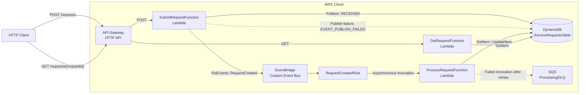

# Event-Driven Request Processing Platform

**An independent AWS serverless proof of concept that accepts service requests, processes domain events asynchronously, and exposes persisted request status.**


**Project Type:** Independent Engineering / Architecture Project  
**Status:** Proof of Concept  
**My Role:** Architecture, Design & Implementation  
**Repository:** https://github.com/manuonsky/event-driven-request-processing-platform  
**Live Demo:** **[TO CONFIRM]**

## 1. Overview

This project explores how to decouple HTTP request acceptance from background processing using AWS-managed services. An API Gateway HTTP API invokes Java Lambda functions to persist service requests in DynamoDB, publish `RequestCreated` events to EventBridge, and retrieve current request state. A separate Lambda processes routed events and stores a priority-based result. The deliberately simple business rule keeps the focus on event contracts, eventual consistency, duplicate handling, and recoverable failure paths.

### Objectives

- Separate synchronous request acceptance from asynchronous processing.
- Model request-state transitions, event routing, and visible failure conditions.
- Define a reproducible serverless architecture using infrastructure as code.

### Key Highlights

- **Architecture:** API Gateway HTTP API, three Java Lambda functions, DynamoDB, a custom EventBridge bus, and an SQS processing dead-letter queue (DLQ).
- **Engineering:** Explicit `RequestCreated` contract, completed-state duplicate check, and publication-failure tracking.
- **Security:** Function-specific, resource-scoped IAM permissions; the demonstration API is **unauthenticated**.
- **Reliability:** Asynchronous Lambda retries, DLQ capture, and a synthetic processor-failure path.
- **Outcome:** Documented asynchronous request lifecycle with queryable state and inspectable failure modes; **not a production deployment**.

## 2. Tech Stack

### Languages & Frameworks


The Lambda handlers use plain Java rather than an application framework.

### Cloud & Infrastructure


### Databases & Messaging


### DevOps & Engineering Tools


### Technology Responsibilities

| Technology | Purpose in This Project |
|------------|-------------------------|
| Java 25, Jackson 3 | Implement Lambda handlers and JSON serialization/deserialization. |
| Apache Maven / Maven Wrapper | Manage project build and dependencies. |
| API Gateway HTTP API, AWS Lambda | Expose submission/query endpoints and execute asynchronous processing. |
| DynamoDB | Store request attributes, timestamps, status, and results by `requestId`. |
| Amazon EventBridge | Route `RequestCreated` events from a custom bus to the processor. |
| Amazon SQS | Retain failed asynchronous processor invocations in a DLQ. |
| AWS SAM, CloudFormation, IAM | Define cloud resources and function-specific permissions. |
| Amazon CloudWatch | Store Lambda operational logs. |

## 3. Implemented Features

### Core Functionality

- [x] Validate `requesterId`, `requestType`, and `priority` for submissions.
- [x] Generate `REQ-<uuid>` request IDs and timestamps; persist an initial `RECEIVED` state.
- [x] Publish `RequestCreated` events to a custom EventBridge bus for asynchronous processing.
- [x] Transition stored requests through `PROCESSING` and `COMPLETED`, with a priority-based result.
- [x] Retrieve request state by ID and return `404 Not Found` for unknown requests.

### Engineering Capabilities

- [x] Skip event processing when the request is already marked `COMPLETED`.
- [x] Record `EVENT_PUBLISH_FAILED` if event publication fails after the initial database write.
- [x] Provide a synthetic failure trigger (`requesterId = FAIL-TEST`) to exercise processor retries and DLQ behavior.
- [x] Emit structured processor logs with request and correlation identifiers.
- [x] Define infrastructure and function-specific IAM permissions through AWS SAM.

### Planned Enhancements

- [ ] Add API authentication and application-level authorization.
- [ ] Introduce client idempotency keys and concurrency-safe state transitions.
- [ ] Strengthen publication guarantees (for example, with an outbox) and automate DLQ redrive/reconciliation.
- [ ] Implement automated tests, CI/CD, distributed tracing, and operational alarms.

## 4. Solution Architecture

### Architecture Diagram



*Dashed arrows represent failure paths. `ProcessingDLQ` captures failed asynchronous Lambda invocations; it does **not** cover EventBridge target-delivery failures.*

### Component Responsibilities

| Component | Responsibility |
|-----------|----------------|
| `SubmitRequestFunction` | Validate input, write `RECEIVED` state, publish an event, and record publication failure. |
| `ServiceRequestsTable` | Persist request metadata, state transitions, timestamps, and processing results. |
| `ServiceRequestEventBus` / `RequestCreatedRule` | Match and route `RequestCreated` events to the processing Lambda. |
| `ProcessRequestFunction` | Read state, skip already-completed requests, apply the processing rule, and update status. |
| `GetRequestFunction` | Return the latest stored request state by ID. |
| `ProcessingDLQ` | Retain failed asynchronous processor invocations for inspection and manual recovery. |

### Request / Processing Flow

1. `POST /requests` validates `requesterId`, `requestType`, and `priority`; the submission Lambda creates a `REQ-<uuid>` record with `RECEIVED` status in DynamoDB.
2. The submission Lambda publishes `RequestCreated` to EventBridge. On successful acceptance, the API responds with **`202 Accepted`**; processing may still be pending.
3. An EventBridge rule routes the event to `ProcessRequestFunction`. The processor reads the record, skips requests already in `COMPLETED`, or updates the state through `PROCESSING` to `COMPLETED`.
4. `GET /requests/{requestId}` reads DynamoDB and returns the latest persisted status and result; it returns **`404 Not Found`** for an unknown ID.
5. If publication fails, the request can be marked `EVENT_PUBLISH_FAILED`. Processing errors trigger asynchronous Lambda retries and can lead to the SQS DLQ; a request may remain in `PROCESSING` until manually recovered.

**Processing rule:** `LOW` priority produces `AUTO_COMPLETED`; `MEDIUM` and `HIGH` produce `MANUAL_REVIEW`. Both results are stored with final status `COMPLETED`.

**Event contract:** `source = portfolio.service-request`, `detail-type = RequestCreated`. The event detail includes `requestId`, `requesterId`, `requestType`, `priority`, and `correlationId`; in this PoC, `correlationId` equals `requestId`.

## 5. Key Architecture & Engineering Decisions

| Decision | Rationale / Trade-off |
|----------|------------------------|
| **EventBridge for event routing** | Separates request submission from processing and supports rule-based filtering; introduces eventual consistency and potential duplicate delivery. There is no intermediary buffering queue between EventBridge and the processor. |
| **Plain Java Lambda handlers** | Keep handlers lightweight without Spring Boot startup overhead; processing remains bounded by Lambda execution constraints. |
| **DynamoDB keyed by `requestId`** | Enables direct status queries; a database write and an EventBridge publication cannot be committed atomically in this design. |
| **AWS SAM / CloudFormation** | Keeps cloud resources and IAM policies declarative and reviewable; deployment is CLI-driven rather than CI/CD-managed. |

### Technical Challenges

**Challenge 1: Non-atomic database write and event publication**

- **Context:** Persisting the initial request and calling EventBridge `PutEvents` are separate operations, so a request may be stored without a corresponding event.
- **Approach:** Set request status to `EVENT_PUBLISH_FAILED` when publication fails after persistence.
- **Result:** The failure is visible in the stored state, but the design does not provide atomic publication or automated reconciliation.

**Challenge 2: Duplicate events and failed asynchronous processing**

- **Context:** Events can be delivered more than once, and a processor failure can interrupt a state transition.
- **Approach:** Check for `COMPLETED` before processing; use asynchronous Lambda retries and an SQS DLQ, with `FAIL-TEST` as a synthetic failure trigger.
- **Result:** Completed requests can be skipped and failed invocations retained for inspection. The state check is **not atomic idempotency**; redrive and state recovery remain manual.

## 6. Security, Reliability & Observability

### Security

- **Implemented:** Function-specific, resource-scoped IAM permissions for required DynamoDB, EventBridge, and SQS operations.
- **Known limitation:** The demonstration HTTP API has **no authentication**; application-level authorization and audit controls are not documented.
- **Configuration and data protection:** Secrets-management arrangements and explicit data-protection settings are **[TO CONFIRM]**. Do not commit AWS credentials or secrets.

### Reliability

- **Failure visibility:** `EVENT_PUBLISH_FAILED` records a failed publish after persistence; synthetic processor failures expose retry/DLQ behavior.
- **Retry and recovery:** Asynchronous Lambda retries and `ProcessingDLQ` are part of the design. Automated DLQ redrive and state reconciliation are not implemented/documented.
- **Consistency:** Request queries reflect persisted state; there is no transactional outbox, concurrency-safe idempotency, or end-to-end exactly-once guarantee.

### Observability

- **Logging:** CloudWatch Lambda logs include structured processor fields such as `requestId`, `correlationId`, `eventType`, `status`, and `result` where applicable.
- **Not documented:** Custom metrics, dashboards, operational alarms, and distributed tracing.

Inspect processor logs with the AWS SAM CLI:

```powershell
sam logs --name ProcessRequestFunction `
  --stack-name event-driven-request-processing `
  --start-time "10min ago"
```

### Non-Functional Considerations

- **Performance:** Latency, throughput, and load-test measurements are **[TO CONFIRM]**.
- **Scalability:** Stateless handlers and managed AWS services provide a serverless scaling model; service limits, contention, and backpressure have not been evaluated in the supplied documentation.
- **Availability:** No production service-level objective, availability measurement, or recovery-time target is documented (**[TO CONFIRM]**).
- **Cost:** Cloud cost estimates and measured operating costs are **[TO CONFIRM]**.

## 7. API / Interface Documentation

| Method | Endpoint | Purpose |
|--------|----------|---------|
| `POST` | `/requests` | Accept a service request (`202 Accepted`; invalid input: `400 Bad Request`). |
| `GET` | `/requests/{requestId}` | Retrieve persisted status (`200 OK`; unknown ID: `404 Not Found`). |

### Example Request / Response

**Example submission:**

```http
POST /requests
Content-Type: application/json
```

```json
{
  "requesterId": "USER-10001",
  "requestType": "STANDARD",
  "priority": "MEDIUM"
}
```

Supported `requestType` values: `STANDARD`, `EXPRESS`. Supported `priority` values: `LOW`, `MEDIUM`, `HIGH`.

**Example `202 Accepted` response:**

```json
{
  "requestId": "REQ-e638721d-b63c-455b-b1e1-635152ef1452",
  "status": "RECEIVED",
  "message": "Request accepted for asynchronous processing"
}
```

**Example `GET /requests/{requestId}` response after processing:**

```json
{
  "requestId": "REQ-e638721d-b63c-455b-b1e1-635152ef1452",
  "requesterId": "USER-10001",
  "requestType": "STANDARD",
  "priority": "MEDIUM",
  "status": "COMPLETED",
  "result": "MANUAL_REVIEW",
  "createdAt": "2026-09-22T10:30:00Z",
  "updatedAt": "2026-09-22T10:30:02Z"
}
```

**API Documentation:** Published OpenAPI/Swagger or Postman reference **[TO CONFIRM]**.

## 8. Getting Started

### Prerequisites

- Java 25 and Maven (or the included Maven Wrapper).
- AWS CLI and AWS SAM CLI.
- AWS credentials configured with permissions to deploy the defined resources.

### Installation

```bash
git clone https://github.com/manuonsky/event-driven-request-processing-platform.git
cd event-driven-request-processing-platform
```

### Configuration

The repository documents an AWS SAM template (`template.yaml`) and SAM configuration (`samconfig.toml`). Configure AWS credentials locally and review the SAM deployment configuration before deploying. Additional environment variables, parameters, and configuration requirements are **[TO CONFIRM]**. Never commit credentials, tokens, or production secrets.

### Running Locally

Local Lambda invocation, event fixtures, or a local service-emulation workflow are **[TO CONFIRM]**. The documented build and deployment procedure below targets AWS; it is not a verified local end-to-end run procedure.

### Deployment

From the repository directory, validate credentials and deploy the SAM stack:

```powershell
aws sts get-caller-identity
sam validate
sam build
sam deploy --guided
```

Use `event-driven-request-processing` as the suggested stack name. Subsequent deployments can use `sam deploy` with saved SAM configuration.

Retrieve the deployed API URL from the CloudFormation stack output:

```powershell
aws cloudformation describe-stacks `
  --stack-name event-driven-request-processing `
  --query "Stacks[0].Outputs[?OutputKey=='ApiUrl'].OutputValue" `
  --output text
```

These are documented deployment instructions; a deployment execution record was not provided.

## 9. Testing & Validation

### Testing Approach

- **Unit Tests:** Test implementation and framework **[TO CONFIRM]**.
- **Integration Tests:** Automated integration coverage **[TO CONFIRM]**.
- **API Tests:** Request/response contracts are documented; recorded execution evidence **[TO CONFIRM]**.
- **Performance Tests:** Load-test methodology and results **[TO CONFIRM]**.
- **Failure Scenarios:** The design includes `FAIL-TEST` processing failures, duplicate-completion checks, and publication-failure state tracking; executed test evidence **[TO CONFIRM]**.

### Validation Results

The entries below are **documented expected behaviors, not independently verified test results**.

| Scenario | Result |
|----------|--------|
| Submit `LOW` priority | Expected: `COMPLETED` / `AUTO_COMPLETED`. |
| Submit `MEDIUM` or `HIGH` priority | Expected: `COMPLETED` / `MANUAL_REVIEW`. |
| Invalid request / unknown request ID | Expected: `400 Bad Request` / `404 Not Found`. |
| Submit `requesterId = FAIL-TEST` | Expected: failure after `PROCESSING`, asynchronous retries, and eventual DLQ handling. |
| Redeliver an event for a completed request | Expected: processor skips further work. |
| Event publication fails after persistence | Expected: stored status `EVENT_PUBLISH_FAILED`. |

**Test Evidence:** Automated test reports, CI runs, or recorded validation output **[TO CONFIRM]**.

## 10. Demonstration & Results

### Screenshots / Demo

Live demo, screenshots, and recorded validation artifacts are **[TO CONFIRM]**. The documented demonstration scenarios are request submission, asynchronous status retrieval, priority-based results, and synthetic failure/DLQ inspection.

### Demonstrated Outcomes

- **Functional:** Documented `202 Accepted` submission, persisted status retrieval, and priority-based completion outcomes.
- **Engineering:** Documented handling for publish failure, completed-request redelivery, and failed processor invocations.
- **Architecture:** An independently designed event-driven, serverless PoC with SAM-defined infrastructure and explicit eventual-consistency trade-offs.
- **Performance:** Measured latency, throughput, availability, or cost results **[TO CONFIRM]**.

These capabilities are described in the supplied project README; source code, deployment records, and independently verified execution evidence were not supplied. No production deployment or quantified business benefit is claimed.

## 11. Repository Structure

```text
event-driven-request-processing/
├── README.md
├── template.yaml
├── samconfig.toml
├── pom.xml
├── mvnw
├── mvnw.cmd
├── .mvn/
├── src/
│   └── main/java/com/example/eventdrivenrequest/
│       ├── model/CreateRequest.java
│       ├── submit/SubmitRequestHandler.java
│       ├── process/ProcessRequestHandler.java
│       └── query/GetRequestHandler.java
└── docs/
    └── decisions/
        └── ADR-001-eventbridge.md
```

*Repository structure is transcribed from the supplied README and has not been independently verified against project source files.*