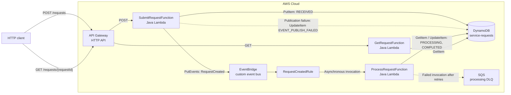

# Event-Driven Request Processing Platform

**An independent AWS serverless proof of concept that accepts HTTP service requests, processes domain events asynchronously, and exposes persisted request state.**


**Project Type:** Independent Engineering / Architecture Project  
**Status:** Proof of Concept  
**My Role:** Architecture, Design & Implementation  
**Repository:** **[TO CONFIRM — direct repository URL]**  
**Live Demo:** **[TO CONFIRM — availability]**

---

## 1. Overview

This project demonstrates an event-driven request lifecycle on AWS. An HTTP API validates and persists a service request, publishes a `RequestCreated` event, and returns without waiting for downstream processing. A separate Lambda consumer updates the request state, which clients can retrieve through a status endpoint.

The business rule is intentionally simple. The engineering focus is on service boundaries, eventual consistency, non-atomic writes, duplicate events, and failure visibility—not on domain complexity. This is an independent reference implementation using synthetic data, **not a production system or a client implementation**.

### Objectives

- Decouple synchronous API acceptance from asynchronous request processing.
- Model request state transitions and make event-processing failures inspectable.
- Define infrastructure as code and document architecture choices and their limitations.

### Key Highlights

- **Architecture:** API Gateway HTTP API, three Java Lambda functions, DynamoDB, a custom EventBridge bus, and an SQS processing DLQ.
- **Engineering:** Explicit API/event contracts, duplicate-event checks, and publication-failure state tracking.
- **Security:** Resource-scoped, function-specific IAM permissions; the HTTP API is intentionally unauthenticated.
- **Reliability:** Asynchronous Lambda retries, an SQS DLQ, and a synthetic processing-failure path.
- **Outcome:** A documented implementation of request acceptance, state queries, asynchronous processing, and failure scenarios. No production or performance metrics are available.

---

## 2. Tech Stack

### Languages & Build


### Cloud & Infrastructure


### Data & Messaging


### Operations & Delivery


### Technology Responsibilities

| Technology | Responsibility |
|---|---|
| Java 25, Jackson 3 | Lambda request handlers and JSON deserialization |
| Maven / Maven Wrapper | Dependency management and build |
| API Gateway HTTP API | `POST /requests` and `GET /requests/{requestId}` |
| AWS Lambda | Request submission, event processing, and state queries |
| DynamoDB | Request records, status, results, and timestamps, keyed by `requestId` |
| Amazon EventBridge | Custom event bus and `RequestCreated` routing rule |
| Amazon SQS | Dead-letter queue for failed asynchronous processing invocations |
| Amazon CloudWatch | Lambda operational logs |
| AWS IAM | Permissions scoped to each function's resources and actions |
| AWS SAM / CloudFormation | Infrastructure definition and CLI-based deployment |

---

## 3. Implemented Features

### Core Functionality

- [x] Validate `requesterId`, `requestType`, and `priority` on submission.
- [x] Create `REQ-<uuid>` identifiers and timestamps; persist requests as `RECEIVED`.
- [x] Publish `RequestCreated` to a custom EventBridge event bus.
- [x] Process routed events asynchronously; persist `PROCESSING` and `COMPLETED` states and a result.
- [x] Retrieve current request state by ID, including `404 Not Found` for unknown IDs.

### Engineering Capabilities

- [x] Skip processing when a request is already `COMPLETED` (non-atomic duplicate-event check).
- [x] Mark a persisted request `EVENT_PUBLISH_FAILED` if its event publication fails.
- [x] Exercise processor exceptions with `requesterId = FAIL-TEST`, allowing Lambda retries and DLQ handling.
- [x] Emit processing logs with request and correlation identifiers.
- [x] Declare the AWS resources and function-specific IAM permissions through SAM.

### Planned Enhancements — Not Implemented

Client-side idempotency, stronger publication guarantees, API authentication, automated tests, CI/CD, tracing, operational alarms, and automated recovery are **not part of the documented implementation**. See [Section 11](#11-limitations--future-improvements).

---

## 4. Solution Architecture

### Architecture Diagram



*Dashed arrows show failure handling, not the normal request path. The SQS DLQ is associated with failed **asynchronous Lambda processing invocations**, not EventBridge target-delivery failures.*

### Component Responsibilities

| Component | Responsibility |
|---|---|
| `SubmitRequestFunction` | Validate input, persist the initial request, publish the domain event, and record publication failure |
| `ServiceRequestsTable` (`service-requests`) | Store request attributes, status, result, and timestamps |
| `ServiceRequestEventBus` and `RequestCreatedRule` | Match events by `source` and `detail-type`, then route them to the processor |
| `ProcessRequestFunction` | Load current state, check completion, apply the priority rule, and update the request |
| `GetRequestFunction` | Retrieve a request by `requestId` |
| `ProcessingDLQ` (`service-request-processing-dlq`) | Retain failed asynchronous invocations after retries |

### Request / Processing Flow

1. `POST /requests` validates the payload, creates a `REQ-<uuid>` ID, and writes a `RECEIVED` record to DynamoDB.
2. The submit handler calls EventBridge `PutEvents`. Successful acceptance returns **`202 Accepted`**, which does not imply that processing has completed.
3. The EventBridge rule routes `RequestCreated` to the processing Lambda asynchronously.
4. The processor reads the record, skips one already marked `COMPLETED`, or transitions it through `PROCESSING` to `COMPLETED` and writes the result.
5. `GET /requests/{requestId}` reads the latest stored representation. If event publication fails, the submit handler records `EVENT_PUBLISH_FAILED`; an unhandled processing failure is eligible for asynchronous retries and eventual DLQ delivery.

**State model:** `RECEIVED → PROCESSING → COMPLETED`. A publication failure can result in `EVENT_PUBLISH_FAILED`. A processing failure may leave the record in `PROCESSING` until manually recovered.

**Demonstration business rule:**

| Priority | Processing result |
|---|---|
| `LOW` | `AUTO_COMPLETED` |
| `MEDIUM` | `MANUAL_REVIEW` |
| `HIGH` | `MANUAL_REVIEW` |

---

## 5. Key Architecture & Engineering Decisions

| Decision | Rationale and trade-off |
|---|---|
| **EventBridge instead of direct invocation or queue-only routing** | Decouples producer and consumer and allows content-based routing and potential additional consumers. Introduces eventual consistency, duplicate-delivery concerns, and operational complexity. An EventBridge → SQS → consumer buffering stage is **not implemented**. |
| **Plain Java Lambda handlers without Spring Boot** | Keeps the demonstration explicit and avoids framework startup/context overhead. The design is intended for short-running handlers, not long-lived workloads that might warrant containers. |
| **DynamoDB with `requestId` as key** | Supports the point-lookup status-query access pattern. It does not provide a transaction across persistence and EventBridge publication. |
| **AWS SAM / CloudFormation** | Captures AWS resources and IAM configuration in reviewable infrastructure code. Deployment is CLI-driven; no CI/CD pipeline is documented. |

### Technical Challenges

**Non-atomic persistence and event publication**

- **Context:** DynamoDB `PutItem` and EventBridge `PutEvents` are separate operations. Persistence can succeed while event publication fails.
- **Implemented approach:** Detect the publication failure and update the request to `EVENT_PUBLISH_FAILED`.
- **Boundary:** The failure is visible but not automatically reconciled. No transactional outbox, atomic delivery guarantee, or recovery worker is implemented.

**At-least-once processing and failed invocations**

- **Context:** A delivered event may be duplicated, and a processor exception must not be mistaken for completion.
- **Implemented approach:** Check for an existing `COMPLETED` state, inject a failure through `FAIL-TEST`, and use asynchronous Lambda retries with an SQS DLQ.
- **Boundary:** The read-then-update check is **not concurrency-safe idempotency**; the DLQ provides an inspection point, not automatic redrive or record reconciliation.

For the event-routing rationale, see [ADR-001 — EventBridge selection](docs/decisions/ADR-001-eventbridge.md).

---

## 6. Security, Reliability & Observability

### Security

- **Scoped IAM:** Submission uses DynamoDB `PutItem`/`UpdateItem` and EventBridge `PutEvents`; processing uses DynamoDB `GetItem`/`UpdateItem` and SQS `SendMessage`; querying uses DynamoDB `GetItem`. The documented policies target the relevant table, event bus, and DLQ.
- **Explicit boundary:** The HTTP API is **unauthenticated** and uses synthetic data. Application authentication, authorization, data masking, and audit controls are not documented.

### Reliability

- Asynchronous Lambda retries and an SQS DLQ provide a failure-inspection path.
- `EVENT_PUBLISH_FAILED` identifies a failed publication after persistence, but does not close the dual-write consistency gap.
- A completed-state check avoids some duplicate work; concurrent deliveries and retried client submissions are not fully idempotent.
- No automated DLQ redrive or reconciliation mechanism is documented.

### Observability

- CloudWatch captures Lambda operational logs. The processing handler emits structured entries with fields such as `requestId`, `requesterId`, `correlationId`, `eventType`, `status`, and `result` when applicable.
- This PoC sets `correlationId = requestId` in its event detail.
- Dashboards, alarms, custom application metrics, and distributed tracing are **not documented**.

```powershell
sam logs --name ProcessRequestFunction `
  --stack-name event-driven-request-processing `
  --start-time "10min ago"
```

### Non-Functional Considerations

- **Scalability:** Stateless Lambda handlers and managed services provide a serverless scaling model; no load, concurrency, or capacity validation is supplied.
- **Consistency:** Clients can observe intermediate status while asynchronous work is in progress.
- **Availability / performance / cost:** No SLOs, uptime measurements, latency or throughput benchmarks, or cost results are documented. Managed services alone do not establish production readiness.

---

## 7. API / Interface Documentation

| Method | Endpoint | Purpose | Documented responses |
|---|---|---|---|
| `POST` | `/requests` | Validate, persist, and publish a service request | `202 Accepted`; `400 Bad Request` for invalid input |
| `GET` | `/requests/{requestId}` | Return the latest stored request state | `200 OK`; `404 Not Found` for an unknown ID |

### Submit Request

```http
POST /requests
Content-Type: application/json
```

```json
{
  "requesterId": "USER-10001",
  "requestType": "STANDARD",
  "priority": "MEDIUM"
}
```

Valid `requestType` values: `STANDARD`, `EXPRESS`. Valid `priority` values: `LOW`, `MEDIUM`, `HIGH`.

**Example `202 Accepted` response:**

```json
{
  "requestId": "REQ-e638721d-b63c-455b-b1e1-635152ef1452",
  "status": "RECEIVED",
  "message": "Request accepted for asynchronous processing"
}
```

### Query Request Status

```http
GET /requests/REQ-e638721d-b63c-455b-b1e1-635152ef1452
```

**Example `200 OK` response after completion:**

```json
{
  "requestId": "REQ-e638721d-b63c-455b-b1e1-635152ef1452",
  "requesterId": "USER-10001",
  "requestType": "STANDARD",
  "priority": "MEDIUM",
  "status": "COMPLETED",
  "result": "MANUAL_REVIEW",
  "createdAt": "2026-09-22T10:30:00Z",
  "updatedAt": "2026-09-22T10:30:02Z"
}
```

### Published Domain Event

The EventBridge envelope uses `source = portfolio.service-request` and `detail-type = RequestCreated`. In this PoC, `correlationId` is the same as `requestId`.

```json
{
  "source": "portfolio.service-request",
  "detail-type": "RequestCreated",
  "detail": {
    "requestId": "REQ-e638721d-b63c-455b-b1e1-635152ef1452",
    "requesterId": "USER-10001",
    "requestType": "STANDARD",
    "priority": "MEDIUM",
    "correlationId": "REQ-e638721d-b63c-455b-b1e1-635152ef1452"
  }
}
```

**OpenAPI specification / Postman collection:** **[TO CONFIRM — no link supplied]**.

---

## 8. Getting Started

### Prerequisites

- Java 25 and Maven (or the included Maven Wrapper).
- AWS CLI and AWS SAM CLI.
- AWS credentials configured for an account in which the stack can be deployed.

### Installation and Configuration

**Repository clone URL:** **[TO CONFIRM]**. Once available, clone the repository and open the `event-driven-request-processing` directory.

Infrastructure is declared in [`template.yaml`](template.yaml), with deployment configuration documented in [`samconfig.toml`](samconfig.toml). Verify the active AWS identity:

```powershell
aws sts get-caller-identity
```

**Additional deployment parameters or environment variables:** **[TO CONFIRM — none specified in the supplied project documentation]**. Do not commit AWS credentials or secrets.

### Build and AWS Deployment

```powershell
sam validate
sam build
sam deploy --guided
```

Use `event-driven-request-processing` as the suggested CloudFormation stack name. For subsequent deployments using saved SAM configuration:

```powershell
sam deploy
```

Retrieve the API endpoint from the stack's `ApiUrl` output:

```powershell
aws cloudformation describe-stacks `
  --stack-name event-driven-request-processing `
  --query "Stacks[0].Outputs[?OutputKey=='ApiUrl'].OutputValue" `
  --output text
```

**Local Lambda execution procedure:** **[TO CONFIRM — no verified local run instructions supplied]**. The documented workflow deploys to AWS.

---

## 9. Testing & Validation

### Documented Validation Scenarios

The following are **expected behaviors from the project documentation**, not evidence of independently executed or automated tests.

| Scenario | Input / condition | Expected behavior |
|---|---|---|
| Low priority | `STANDARD`, `LOW` | `COMPLETED`, `AUTO_COMPLETED` |
| Medium priority | `STANDARD`, `MEDIUM` | `COMPLETED`, `MANUAL_REVIEW` |
| High priority | `EXPRESS`, `HIGH` | `COMPLETED`, `MANUAL_REVIEW` |
| Invalid submission | Missing `requestType` or `priority` | `400 Bad Request` |
| Missing record | Unknown `requestId` | `404 Not Found` |
| Synthetic processor failure | `requesterId = FAIL-TEST` | Request accepted; processor fails after `PROCESSING`; retries and then DLQ |
| Duplicate event | Stored state already `COMPLETED` | Processing skipped |

### API Smoke Test (PowerShell)

Replace the placeholder with the `ApiUrl` returned by CloudFormation:

```powershell
$API_URL = "https://<api-id>.execute-api.<region>.amazonaws.com"
$body = @{
    requesterId = "USER-LOW"
    requestType = "STANDARD"
    priority = "LOW"
} | ConvertTo-Json

$response = Invoke-RestMethod -Method Post -Uri "$API_URL/requests" `
  -ContentType "application/json" -Body $body
$response

# Asynchronous processing may not be finished yet; query again if needed.
Invoke-RestMethod -Method Get -Uri "$API_URL/requests/$($response.requestId)"
```

**Automated unit, integration, API/event-contract, and performance tests; execution reports:** **[TO CONFIRM — no suites or results provided]**.

---

## 10. Demonstration & Results

### Demonstrable Technical Outcomes

- **Asynchronous API boundary:** `POST /requests` returns `202 Accepted` with `RECEIVED` without waiting for the processor.
- **Persisted state:** Subsequent queries can return intermediate state and the eventual priority-based result.
- **Failure visibility:** A publication failure is represented by `EVENT_PUBLISH_FAILED` rather than silently remaining `RECEIVED`.
- **Failure-path exercise:** `FAIL-TEST` triggers a processor exception after the `PROCESSING` update, enabling inspection of retry/DLQ behavior.

These are **documented capabilities and expected demonstrations**, not measured service-level results or proof of production operation.

**Screenshots, recording, deployment outputs, or executed test evidence:** **[TO CONFIRM]**.  
**Measured latency, throughput, error rate, availability, or cost:** **[TO CONFIRM — not provided]**.

---

## 11. Limitations & Future Improvements

### Current Limitations

- The HTTP API has no authentication/authorization or client-provided idempotency key.
- DynamoDB persistence and EventBridge publication are non-atomic; no outbox or publication reconciler is implemented.
- The completed-state check does not enforce concurrency-safe or exactly-once processing.
- Failed processing may leave a record at `PROCESSING`; the DLQ requires manual operational recovery.
- Automated testing, CI/CD, tracing, dashboards, alarms, metrics-based monitoring, and DLQ redrive are not documented.
- No event schema versioning, multi-region recovery design, quantified non-functional targets, or production-readiness evidence is provided.

### Planned Improvements — Not Implemented

- [ ] Add client idempotency keys and concurrency-safe conditional state transitions.
- [ ] Evaluate a transactional outbox or DynamoDB Streams-based publication/reconciliation approach.
- [ ] Add API authentication/authorization and define data retention, masking, and audit requirements where applicable.
- [ ] Define event schema ownership, versioning, and compatibility rules.
- [ ] Add unit, integration, API/event-contract, duplicate-delivery, and failure-injection test automation.
- [ ] Add CloudWatch application metrics, alarms, DLQ monitoring, dashboards, tracing, and SLI/SLO definitions.
- [ ] Automate build/test/deployment through CI/CD and implement documented DLQ recovery/redrive procedures.

---

## 12. Repository Structure

```text
event-driven-request-processing/
├── README.md
├── template.yaml
├── samconfig.toml
├── pom.xml
├── mvnw
├── mvnw.cmd
├── .mvn/
├── src/
│   └── main/java/com/example/eventdrivenrequest/
│       ├── model/CreateRequest.java
│       ├── submit/SubmitRequestHandler.java
│       ├── process/ProcessRequestHandler.java
│       └── query/GetRequestHandler.java
└── docs/
    └── decisions/
        └── ADR-001-eventbridge.md
```

*Directory structure is reproduced from the supplied project README. Source files and infrastructure definitions were not provided for independent inspection.*

---

## 13. Engineering Notes & References

- [ADR-001 — EventBridge selection](docs/decisions/ADR-001-eventbridge.md)
- [AWS SAM infrastructure template](template.yaml)
- [SAM deployment configuration](samconfig.toml)
- [Maven project configuration](pom.xml)
- **Verification scope:** Technical claims and examples are derived from the supplied README, not independently checked against source code, deployments, or test reports.
- **Project context:** Independent, hands-on solution architecture and engineering work with a synthetic domain; no employer/client implementation or production experience is implied.

**Developed by:** Manoj Parambil  
**Professional focus:** Solution architecture with hands-on engineering  
**Portfolio:** https://manuonsky.com  
**LinkedIn:** https://www.linkedin.com/in/manoj-parambil/  
**GitHub:** https://github.com/manuonsky  
**Direct project repository:** **[TO CONFIRM]**  
**License:** **[TO CONFIRM]**
